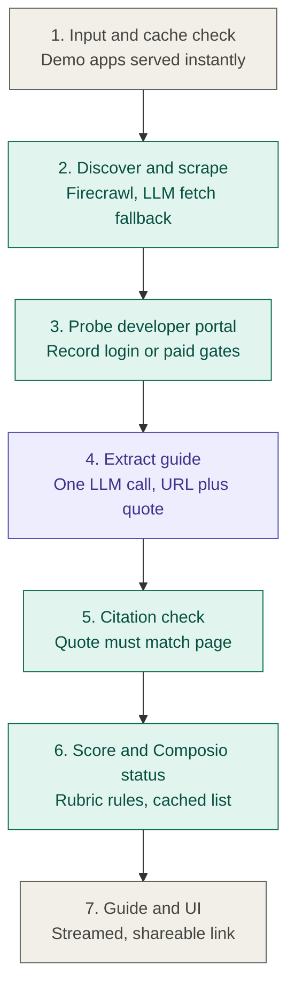

# Clearance

An agent that tells developers how hard it is to get their OAuth app approved with any provider, how long it will take, what might block them, and what they must do themselves, with every claim labelled by how it was verified.

## Architecture

Only stage 4 uses an LLM. Everything else is tools or plain code.