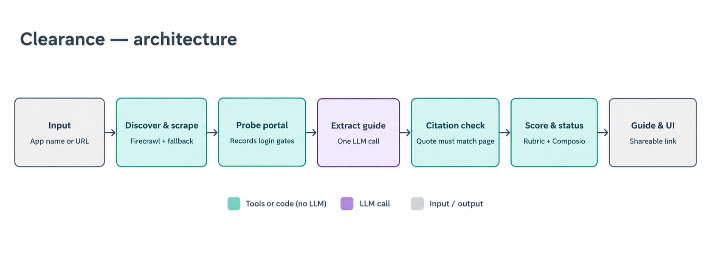

# Clearance

An agent that tells developers how hard it is to get their OAuth app approved with any provider, how long it will take, what might block them, and what they must do themselves, with every claim labelled by how it was verified.

**Live app:** [clearance-composiodev.streamlit.app](https://clearance-composiodev.streamlit.app/)

**Write-up:** [Composio API integrations submission](https://payalkanyan.notion.site/Composio-API-Integrations-submission-409ca56ea64d8015b052f6bf984db5e0)

## Architecture



Only stage 4 uses an LLM. Everything else is tools or plain code.

## How honesty is enforced

The evidence labels in [docs/guide-spec.md](docs/guide-spec.md) are not requests in a prompt. They hold because of where each label can come from:

| Label | Who may produce it | How it is enforced |
|---|---|---|
| **Tested** | stage 3 only, in code | The draft schema's label enum offers only the other three, so the model cannot emit `Tested`. These facts are written from what the agent saw when it opened a page, with URL, HTTP status and a UTC timestamp. |
| **Sourced** | the model, then checked | Requires a `source_url` from the supplied official pages and a quote under 25 words. Stage 5 looks for that quote in the cached text of that page; if it is not there, the fact is downgraded to `Inferred` with a note. |
| **Inferred** | the model, or a downgrade | Reasoning, not a claim about what a page says. |
| **Uncertain** | the model | Preferred over guessing. |

Difficulty is never the model's to decide: the rubric in [clearance/rubric.py](clearance/rubric.py) runs in code and records the fact that triggered the level, so you can disagree with it. Composio status comes from Composio's own page, quoted.

A failed search is never reported as a finding: if no official page could be read, the run fails with a reason rather than claiming the app has no OAuth.

## Run it yourself

```bash
git clone https://github.com/payalkanyan/Clearance.git
cd Clearance

python -m venv .venv && source .venv/bin/activate
pip install -r requirements.txt

cp .env.example .env          # then put your two keys in it
```

Python 3.11 or newer. If you use [uv](https://docs.astral.sh/uv/), `uv venv && uv pip install -r requirements.txt` does the same thing faster.

Then open the app:

```bash
streamlit run app.py
```

The guides already in `guides/` are part of the repository, so the library and every guide page work straight after cloning, with no keys at all. Keys are only needed to generate a new guide.

### The two keys

Both are free:

- **`FIRECRAWL_API_KEY`** from [firecrawl.dev](https://firecrawl.dev) — 1000 credits on signup, and a guide costs about 20.
- **`GEMINI_API_KEY`** from [aistudio.google.com/apikey](https://aistudio.google.com/apikey) — `gemini-3.8-flash` is free-tier eligible, so a guide costs nothing.

A value containing `xxxx` is treated as unset and deleted from the environment, because the SDKs read these variables themselves and would otherwise send the placeholder from `.env.example` as a real credential.

## Usage

```bash
python -m clearance.run "Spotify"            # build a guide, or serve the saved one
python -m clearance.run "Spotify" --refresh  # rebuild from cached stages, no model call
python -m clearance.run "Notion" --no-cache  # re-scrape and re-extract from scratch
python -m clearance.compare github           # diff the agent's guide against the hand-written one
python -m clearance.compare --difficulty     # difficulty across every guide, against expectations
```

A new app takes three to six minutes, nearly all of it the single model call.

Each run writes `guides/<slug>.json`, a rendered `guides/<slug>.md`, `logs/<slug>.json` (the queries issued, pages scraped, per-stage timings, fallbacks, gates, quote downgrades, tokens and cost) and `cache/<slug>/` (the scraped pages, which are what each quote is checked against).

A guide whose `meta.provenance` is `human-gold` is never overwritten: the agent writes `<slug>.agent.json` beside it. That is why `guides/github.json` stays the hand-written one.

Every stage is also its own entry point — `clearance.discover`, `.probe`, `.extract`, `.citations`, `.composio` — each taking an app name. That is how the pipeline was built, and it is the quickest way to see what one stage decides without running the rest.

## Tests

```bash
pytest -q
```

No network and no model calls: the transport, the search results and the pipeline are stubbed, and the UI runs under Streamlit's `AppTest`.

## Deviations from the brief

- **Gemini instead of Anthropic for stage 4.** No Anthropic billing was available. `LLM_MODEL` selects the model; the call is isolated in [clearance/extract.py](clearance/extract.py).
- **The stage-2 fallback is a plain HTTP fetch, not the Anthropic web fetch tool.** Gemini's nearest equivalent does not return page text verbatim, so it cannot feed the citation check. The `web_fetch` path is still implemented and tested, and `FALLBACK_MODE=auto` uses it when an Anthropic key is present.
- **Composio status reads `composio.dev/toolkits/<slug>` rather than the toolkits list.** `docs.composio.dev/toolkits/managed-auth` renders its list in JavaScript, so scraping it answers nothing about a specific app; it is still cached once for the managed-vs-custom definition.
- **`Difficulty.Unknown` was added** to the spec's four levels, used only when an app has no OAuth to rate. Calling that `Easy` would be a claim the evidence does not support.
