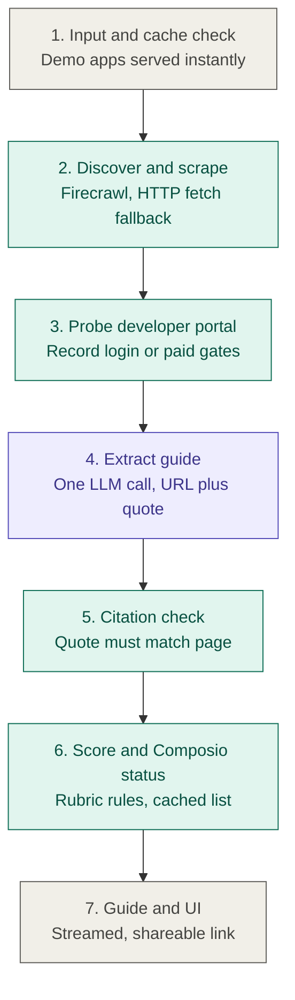

# Clearance

An agent that tells developers how hard it is to get their OAuth app approved with any provider, how long it will take, what might block them, and what they must do themselves, with every claim labelled by how it was verified.

## Architecture



Only stage 4 uses an LLM. Everything else is tools or plain code.

## How honesty is enforced

The evidence labels in [docs/guide-spec.md](docs/guide-spec.md) are not requests in a prompt. They hold because of where each label can come from:

| Label | Who may produce it | How it is enforced |
|---|---|---|
| **Tested** | stage 3 only, in code | The draft schema's label enum offers only the other three, so the model cannot emit `Tested`. These facts are written from what the agent saw when it opened a page, with URL, HTTP status and a UTC timestamp. |
| **Sourced** | the model, then checked | Requires a `source_url` from the supplied official pages and a quote under 25 words. Stage 5 looks for that quote in the cached text of that page; if it is not there, the fact is downgraded to `Inferred` with a note. |
| **Inferred** | the model, or a downgrade | Reasoning, not a claim about what a page says. |
| **Uncertain** | the model | Preferred over guessing. |

Difficulty is never the model's to decide: the rubric in [clearance/rubric.py](clearance/rubric.py) runs in code and records the fact that triggered the level, so you can disagree with it. Composio status comes from Composio's own page, quoted.

A failed search is never reported as a finding: if no official page could be read, the run fails with a reason rather than claiming the app has no OAuth.

## Setup

```bash
uv venv && uv pip install -r requirements.txt
cp .env.example .env     # then add the two keys
```

Two keys, both free:

- `FIRECRAWL_API_KEY` from [firecrawl.dev](https://firecrawl.dev) — 1000 credits. A run costs about 20.
- `GEMINI_API_KEY` from [aistudio.google.com/apikey](https://aistudio.google.com/apikey) — `gemini-3.8-flash` is free-tier eligible.

A value containing `xxxx` is treated as unset and removed from the environment, because the SDKs read these variables themselves and would otherwise send a placeholder as a real credential.

## Usage

```bash
python -m clearance.run "Spotify"            # build or serve a guide
python -m clearance.run "Spotify" --refresh  # rebuild from cached stages
python -m clearance.run "Notion" --no-cache  # re-scrape and re-extract
python -m clearance.compare github           # diff against the gold guide
python -m clearance.compare --difficulty     # difficulty table
streamlit run app.py                         # library, guides, generate
```

Each stage also runs on its own, which is how the pipeline was built and is the
quickest way to see what one of them decides:

```bash
python -m clearance.discover "Spotify"   # stage 2
python -m clearance.probe "Spotify"      # stage 3
python -m clearance.extract "Spotify"    # stage 4
python -m clearance.citations "Spotify"  # stage 5
python -m clearance.composio "Spotify"   # stage 6b
```

Outputs per app: `guides/<slug>.json`, `guides/<slug>.md`, `logs/<slug>.json` (queries, URLs, per-stage timings, fallbacks, gates, downgrades, tokens, cost), and `cache/<slug>/` (the scraped pages a quote is checked against).

A guide whose `meta.provenance` is `human-gold` is never overwritten: the agent writes `<slug>.agent.json` beside it. That is why `guides/github.json` stays the hand-written one.

## Deploying

The app runs unchanged on [Streamlit Community Cloud](https://share.streamlit.io), which is free:

1. Sign in with GitHub and choose **Create app → Deploy a public app from GitHub**.
2. Repository `payalkanyan/Clearance`, branch `main`, main file `app.py`.
3. Open **Advanced settings**, set Python to **3.12** (the code uses `StrEnum` and `X | None`, so 3.11 is the floor), and paste the two keys into **Secrets**:

   ```toml
   FIRECRAWL_API_KEY = "fc-..."
   GEMINI_API_KEY = "AIza..."
   LLM_MODEL = "gemini-3.8-flash"
   ```

Streamlit exports secrets as environment variables, so [clearance/config.py](clearance/config.py) reads them with no deployment-specific code. `.streamlit/secrets.toml` is git-ignored: keys belong in the Secrets box, never in the repository.

Two things to know about a public deployment. The hosted filesystem is temporary, so a guide generated on the live app survives only until it restarts, while the guides committed here are always present. And the Generate page spends your own API credits — roughly 20 Firecrawl credits and one Gemini call per app — for anyone who uses it, so gate or remove that page if you would rather not leave it open.

## Tests

```bash
pytest -q
```

No network and no model calls: the transport, the search results and the pipeline are stubbed, and the UI runs under Streamlit's `AppTest`.

## Deviations from the brief

- **Gemini instead of Anthropic for stage 4.** No Anthropic billing was available. `LLM_MODEL` selects the model; the call is isolated in [clearance/extract.py](clearance/extract.py).
- **The stage-2 fallback is a plain HTTP fetch, not the Anthropic web fetch tool.** Gemini's nearest equivalent does not return page text verbatim, so it cannot feed the citation check. The `web_fetch` path is still implemented and tested, and `FALLBACK_MODE=auto` uses it when an Anthropic key is present.
- **Composio status reads `composio.dev/toolkits/<slug>` rather than the toolkits list.** `docs.composio.dev/toolkits/managed-auth` renders its list in JavaScript, so scraping it answers nothing about a specific app; it is still cached once for the managed-vs-custom definition.
- **`Difficulty.Unknown` was added** to the spec's four levels, used only when an app has no OAuth to rate. Calling that `Easy` would be a claim the evidence does not support.
